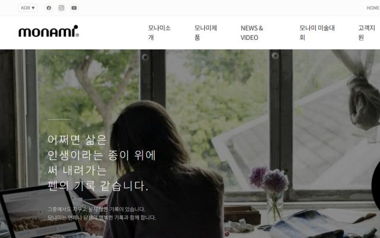

# 모나미(Monami) 홈페이지 클론 코딩

모나미 공식 브랜드스토어의 UI/UX를 React + TypeScript로 재구현한 프론트엔드 클론 코딩 프로젝트입니다.

 

 

## 기술 스택

| 분류 | 기술 |
|------|------|
| Framework | React 18 |
| Language | TypeScript |
| Styling | Tailwind CSS v4 |
| Routing | React Router DOM v6 |
| Build Tool | Vite |
| Icons | Lucide React |
| Deploy | Vercel |

 

## 주요 구현 사항

**동적 라우팅**
`useParams`를 활용한 상품 상세 페이지 단일 템플릿 구조. 상품 id 기반으로 수십 개의 상품 정보를 하나의 `DetailPage.tsx`에서 분기 렌더링.

**MY CART 사이드 드로어**
CSS `transform: translateX` 기반 GPU 가속 슬라이딩 애니메이션 적용.

**드래그 스크롤 캐러셀**
마우스 드래그로 상품을 가로 스크롤할 수 있는 캐러셀 구현. 5px 임계값 분기로 클릭과 드래그를 구분하고, 이미지 고스트 현상 차단.

**반응형 레이아웃**
PC 와이드 해상도부터 모바일까지 대응하는 유동 그리드 레이아웃.

 

## 시작하기

\`\`\`bash
npm install
npm run dev
\`\`\`

 

## 관련 링크

- 배포 URL: https://monami-clone-react.vercel.app
